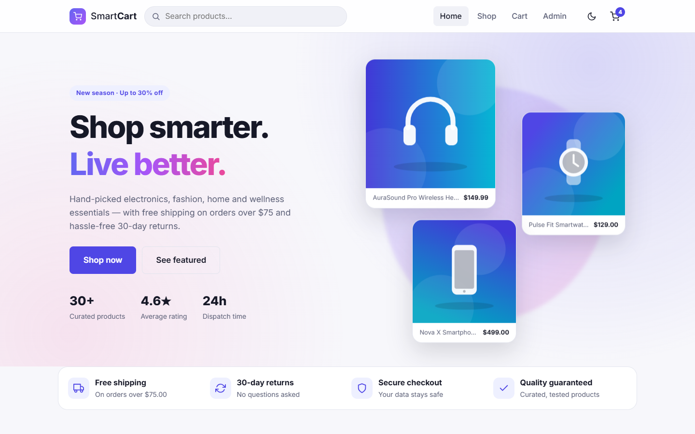
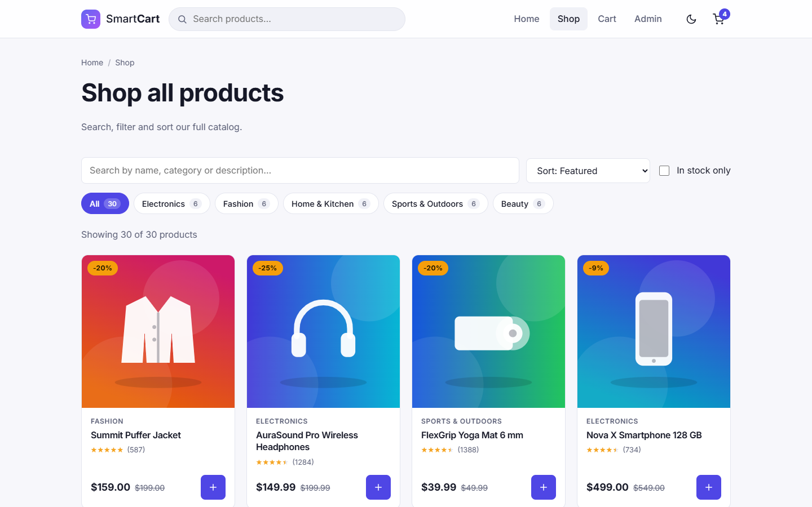
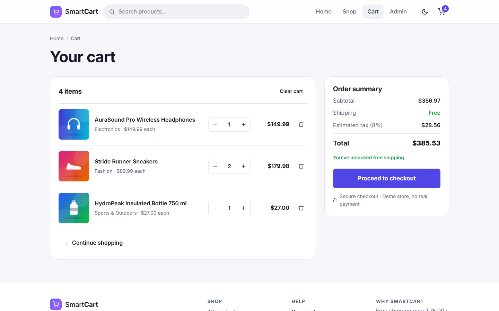
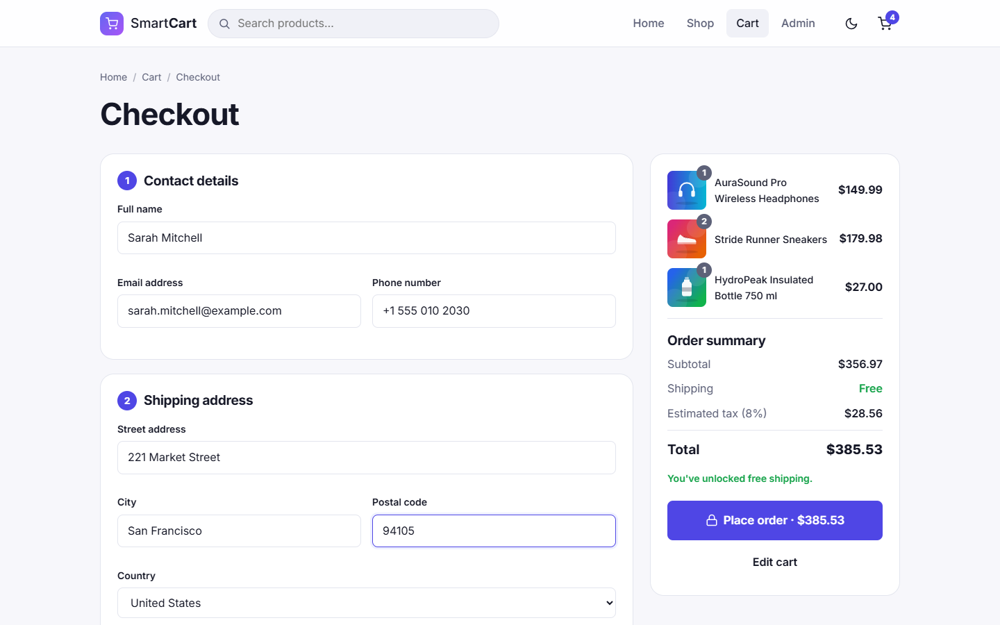
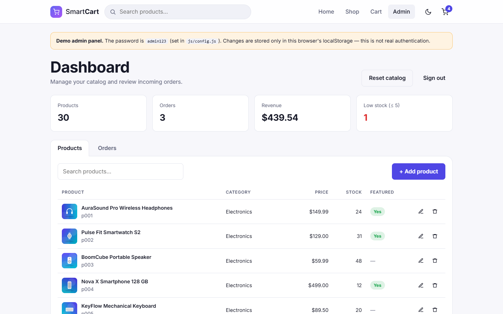
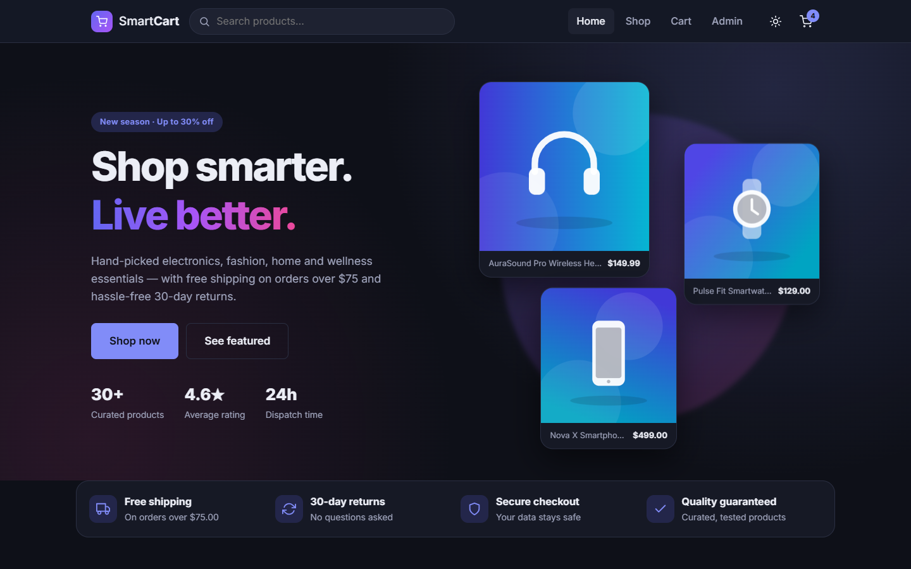
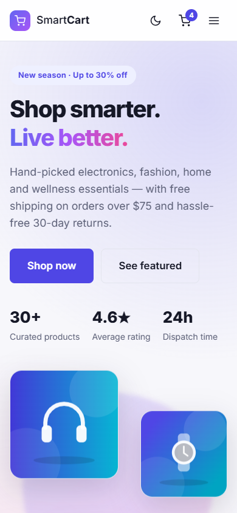

# SmartCart 🛒

**🔗 Live demo: [khizarsys.github.io/smartcart-ecommerce](https://khizarsys.github.io/smartcart-ecommerce/)**

> A complete, responsive e-commerce web app built with pure HTML, CSS and vanilla JavaScript — no frameworks, no build step.


---

## About the project

Most shopping-site tutorials lean on React, a backend and a payment SDK, which hides the fundamentals. **SmartCart** shows that a polished, realistic storefront — catalog, search, cart, checkout and an admin panel — can be built with nothing but the web platform.

The catalog lives in a JSON file and every piece of state (cart, orders, admin edits, theme) is persisted in `localStorage`, so the whole app runs as a static site and can be hosted free on GitHub Pages.

## Features

**Storefront**
- 🏠 **Home page** — hero banner, store perks, shop-by-category grid, featured products and promo banner
- 🛍️ **Shop page** — product grid with live search, category chips, price/rating/name sorting and an "in stock only" filter; filters are synced to the URL so views are shareable
- 📦 **Product detail page** — large image, rating, sale pricing, highlights, stock status, quantity selector and related products
- 🛒 **Cart** — add, update quantity, remove, clear; subtotal, shipping, tax and total; free-shipping progress meter; persisted in `localStorage`; live cart-count badge in the header (synced across tabs)
- ✅ **Checkout** — validated form (name, email, phone, address, postal code, country, terms) with inline errors, order summary, stock re-check, order saved → **thank-you page** with a printable receipt
- 🌗 **Dark / light mode** — follows the OS preference, toggle persists, no flash on load
- 🔔 **Toast notifications** for cart actions, validation and admin events
- 📱 **Fully responsive** — mobile menu, stacked cart lines, card-style admin tables

**Admin panel (demo)**
- 🔐 Password gate (`admin123`, from a config constant — clearly labeled as a demo)
- ➕ Add, ✏️ edit and 🗑️ delete products in an accessible modal form with validation
- 📋 View orders, open order details and update status (Processing → Shipped → Delivered / Cancelled)
- 📊 Dashboard stats: products, orders, revenue, low-stock count
- ♻️ "Reset catalog" restores the original seed data

## Tech stack

| Area | Technology |
| --- | --- |
| Markup | Semantic HTML5, ARIA where needed (tabs, dialogs, live regions) |
| Styling | CSS3 — custom properties (design tokens), Flexbox, Grid, `color-mix()`, media queries |
| Logic | Vanilla JavaScript, native ES6 modules (`import` / `export`) |
| Data | `data/products.json` (30 products, 5 categories) + `localStorage` |
| Hosting | GitHub Pages (static, no build step) |

## Screenshots

| Home | Shop |
| --- | --- |
|  |  |

| Product | Cart |
| --- | --- |
|  |  |

| Checkout | Admin panel |
| --- | --- |
|  |  |

| Dark mode | Mobile |
| --- | --- |
|  |  |

## Folder structure

```
smartcart-ecommerce/
├── index.html            # Home page
├── shop.html             # Product listing, search, filter, sort
├── product.html          # Product detail (product.html?id=p001)
├── cart.html             # Shopping cart
├── checkout.html         # Checkout form
├── thank-you.html        # Order confirmation
├── admin.html            # Demo admin panel
├── css/
│   ├── style.css         # Design tokens, base styles, shared components
│   ├── pages.css         # Page-specific styles
│   └── admin.css         # Admin panel styles
├── js/
│   ├── config.js         # Store settings (tax, shipping, demo admin password)
│   ├── storage.js        # Safe localStorage helpers
│   ├── store.js          # Products & orders data layer
│   ├── cart.js           # Cart logic and totals
│   ├── ui.js             # Header/footer, theme, toasts, product cards, formatting
│   ├── summary.js        # Shared order-summary markup
│   ├── validation.js     # Reusable form validation
│   ├── admin.js          # Admin panel
│   ├── theme-init.js     # Applies the saved theme before first paint
│   └── pages/            # One entry module per page
├── data/
│   └── products.json     # Seed catalog (30 products)
├── assets/images/        # Favicon, product and category illustrations (SVG)
├── screenshots/          # README screenshots
├── .env.example
└── .gitignore
```

## How to run locally

The app uses ES modules and `fetch()`, which browsers block on `file://` URLs, so serve it with any static web server.

1. **Clone the repository**
   ```bash
   git clone https://github.com/khizarsys/smartcart-ecommerce.git
   cd smartcart-ecommerce
   ```
2. **Start a local server** (pick one)
   ```bash
   # Python 3
   python -m http.server 8000

   # or Node.js
   npx serve .
   ```
   You can also use the **Live Server** extension in VS Code.
3. **Open the site** at [http://localhost:8000](http://localhost:8000) (or the port your server prints).
4. **Try the admin panel** at `/admin.html` with the demo password **`admin123`**.

To start fresh at any time, clear the site's `localStorage` from your browser DevTools (Application → Local Storage) or use **Reset catalog** in the admin panel.

## Environment variables

SmartCart is a static site with no build step, so the browser cannot read a `.env` file. `.env.example` documents the values a real deployment with a backend would need:

| Variable | Description | Example |
| --- | --- | --- |
| `ADMIN_PASSWORD` | Admin password for a real, server-side login | `change-me` |
| `SITE_URL` | Public URL where the site is hosted | `https://your-username.github.io/smartcart-ecommerce/` |

Copy it with `cp .env.example .env` if you add a backend; `.env` is git-ignored.

## Design decisions

- **Demo admin password in `js/config.js`.** Client-side code can't keep secrets, so rather than pretending otherwise, the password (`admin123`) is a clearly labeled demo constant shown on the admin page. Real authentication belongs on a server (see *Future improvements*).
- **No card details collected.** Checkout offers "Cash on delivery" and "Card on delivery" so visitors are never asked to type real card numbers into a portfolio demo.
- **Admin edits override the seed file.** After the first admin change (or a placed order, which reduces stock) the full catalog is saved to `localStorage` and used instead of `products.json`. "Reset catalog" removes the override.
- **Orders snapshot product data** (name, price, image) so past orders stay accurate when the catalog changes.
- **Stock is enforced** in the cart, on the product page and again at checkout; quantities are capped at 10 per item.
- **Local SVG illustrations** instead of hot-linked stock photos, so images never break and the repo stays lightweight.
- **Pricing rules** (in `js/config.js`): 8% estimated tax, $7.99 shipping, free shipping on orders of $75 or more.
- **Accessibility:** semantic landmarks, labelled controls, keyboard-friendly tabs and native `<dialog>` modals, visible focus styles, `aria-live` toasts, and reduced-motion support.

## Future improvements

- Real backend (Node.js/Express or Firebase) with server-side authentication and a database
- Payment gateway integration (Stripe test mode)
- Product image uploads and multiple images per product
- Customer accounts with order history and wishlists
- Product reviews and ratings submitted by users
- Discount codes and coupons
- Pagination or infinite scroll for large catalogs
- Unit tests for cart and validation logic (e.g. Vitest) and end-to-end tests (Playwright)
- PWA support for offline browsing

## Author

**Khizar Hayat** — BS Software Engineering, Riphah International University
LinkedIn: [linkedin.com/in/khizar-hayat-dev](https://www.linkedin.com/in/khizar-hayat-dev)
